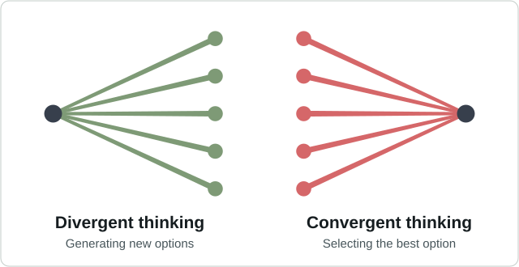

# Brainstorm

You'll see a box to type ideas and a growing list of everyone's contributions.
Add as many as you can — quantity first, judgment later.

> No idea is judged while the list is open — that comes later, and separately.
> Seek quantity, and build on other ideas.

## How to take part

- Type an idea and submit it. Add another. Keep going.
- Every idea is visible to the group as it arrives.
- Build on what others have posted — combine two ideas, or take one further.

## AI suggestions

If your facilitator has switched on AI suggestions, you'll see a tray marked
*only you can see these* below the box where you type.

- **Use your own AI:** open it and copy the prompt. It holds the question and
  your own ideas, nobody else's. Paste it into the AI you use (Claude, ChatGPT,
  Gemini…), then paste the AI's reply back and press **Add to my tray**. Each
  line becomes a suggestion.
- **✨ Suggest ideas**, if you see it, asks Samvinas's own AI for a few ideas.
- Tick the suggestions worth keeping and press **Share selected**. They join
  the list marked as AI-assisted. The rest stay private: dismiss them with ×,
  or **Dismiss all**. **Hide suggestions** folds the tray away.

## Ground rules for great ideas

This is the **divergent** part of the process, where we widen the field of
possibilities.

Four habits make it work:

1. **Delay judgment.** No idea is criticised yet — that comes later. Nothing
   shuts down a group faster than "that won't work."
2. **Build on other ideas.** Use "yes, and…" thinking — treat every post as a
   springboard.
3. **Seek wild and unusual.** The unusual and the impractical often carry the
   seed of something brilliant. It's easier to tame a wild idea than to
   invigorate a safe one.
4. **Seek quantity.** More ideas means more raw material to choose from. Aim
   for a long list.

> There'll be a later step to sort, combine, and choose. For now, let it flow.
